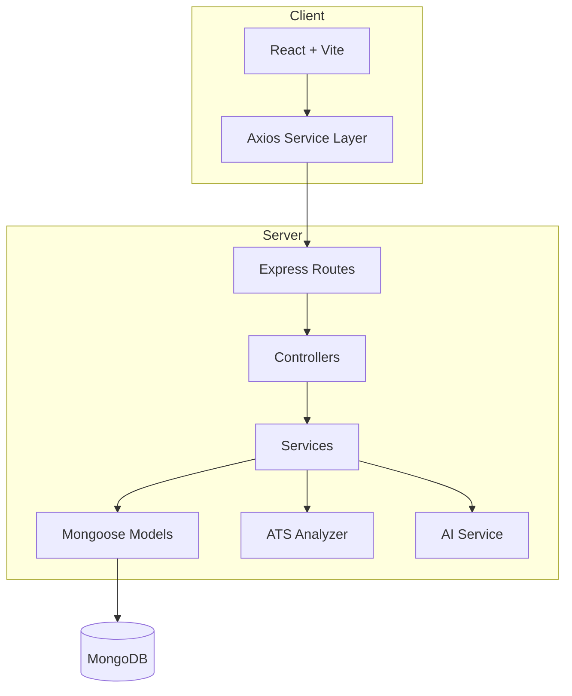

# CareerBridge

**AI-Powered College Placement & Career Portal**

CareerBridge is a full-stack web platform for college placement cells that combines placement management, ATS resume analysis, smart job matching, application tracking, interview scheduling, and analytics — built as a production-quality final-year B.Tech project.

---

## Features

### Student Portal
- Register/login with JWT authentication
- Complete student profile with completion percentage
- Browse companies and job openings with search, filter, sort, pagination
- Smart job matching based on skills, eligibility, and profile
- Apply to jobs with eligibility validation and duplicate prevention
- Track applications with visual timeline
- View interview schedules
- **ATS Resume Analyzer** — deterministic scoring, skill matching, job comparison
- Optional AI-powered resume suggestions (when API configured)
- Resume analysis history with score trends
- Placement results and announcements
- Personal analytics dashboard

### Admin Portal
- Manage students, companies, placement drives, and jobs
- Review applications, update status, schedule interviews
- Publish placement results
- Create announcements
- View placement statistics and charts

---

## Tech Stack

| Layer | Technologies |
|-------|-------------|
| Frontend | React, Vite, Tailwind CSS, React Router, Axios, Recharts, React Hook Form, Zod, Lucide React |
| Backend | Node.js, Express, JWT, bcrypt, Multer, Zod validation |
| Database | MongoDB, Mongoose |
| AI | Replaceable OpenAI-compatible service (optional) |

---

## Architecture



**Request flow:** Route → Controller → Service → Model

---

## Folder Structure

```
careerbridge/
├── client/                 # React frontend
│   └── src/
│       ├── components/     # Reusable UI components
│       ├── pages/          # Student & Admin pages
│       ├── layouts/        # Dashboard layout
│       ├── context/        # Auth & Toast context
│       ├── services/       # API service layer
│       └── utils/
├── server/                 # Express backend
│   └── src/
│       ├── config/         # DB & env config
│       ├── controllers/
│       ├── middleware/     # Auth, upload, errors
│       ├── models/         # Mongoose schemas
│       ├── routes/
│       ├── services/       # Business logic
│       ├── utils/          # Helpers, skill normalizer
│       ├── validators/     # Zod schemas
│       ├── seed/           # Database seed script
│       └── tests/
├── README.md
└── package.json
```

---

## Database Models

- **User** — authentication, roles (STUDENT/ADMIN)
- **StudentProfile** — extended profile, skills, completion
- **Company** — company details, eligibility
- **PlacementDrive** — campus drives
- **Job** — job postings with skills & eligibility
- **Application** — student applications (unique per student+job)
- **Interview** — scheduled interviews
- **Resume** — uploaded PDFs with extracted text
- **ResumeAnalysis** — ATS scores and history
- **Announcement** — placement announcements
- **Result** — placement results
- **Notification** — in-app notifications

---

## API Overview

| Method | Endpoint | Description |
|--------|----------|-------------|
| POST | `/api/auth/register` | Student registration |
| POST | `/api/auth/login` | Login |
| GET | `/api/auth/me` | Current user |
| GET | `/api/students/dashboard` | Student dashboard |
| GET/PUT | `/api/students/profile` | Profile CRUD |
| GET | `/api/companies` | List companies |
| GET | `/api/jobs` | List/search jobs |
| POST | `/api/applications` | Apply to job |
| POST | `/api/resumes/upload` | Upload PDF resume |
| POST | `/api/resume-analysis/analyze` | ATS analysis |
| POST | `/api/resume-analysis/job-match` | Job-specific match |
| GET | `/api/analytics/student` | Student analytics |
| GET | `/api/analytics/admin` | Admin analytics |

Full admin CRUD available for companies, jobs, drives, applications, interviews, results, announcements.

---

## Installation

### Prerequisites
- Node.js 18+
- MongoDB 6+ (local or Atlas)

### Setup

```bash
# Clone and install
cd "AI-Powered College Placement & Career Portal"
npm run install:all

# Configure environment
cp server/.env.example server/.env
cp client/.env.example client/.env
# Edit server/.env with your MONGO_URI and JWT_SECRET
```

### MongoDB Setup

**Local:**
```bash
# Start MongoDB service, then set in server/.env:
MONGO_URI=mongodb://127.0.0.1:27017/careerbridge
```

**MongoDB Atlas:** Create a free cluster and paste the connection string into `MONGO_URI`.

### Seed Database

```bash
npm run seed
```

### Run Development

```bash
# Run both frontend and backend (works on Windows paths with spaces/&)
npm run dev

# Or separately in two terminals:
npm run dev:server   # http://localhost:5000
npm run dev:client   # http://localhost:5173
```

> **Windows note:** If your project folder contains `&` (e.g. `Placement & Career Portal`), use `npm run dev` — it uses Node scripts that avoid shell path issues. Avoid raw `vite`/`concurrently` commands from npm scripts in paths with `&`.

### Run Tests

```bash
npm run test
```

### Build Frontend

```bash
npm run build
```

---

## Demo Credentials

| Role | Email | Password |
|------|-------|----------|
| Student | student@example.com | Student@123 |
| Admin | admin@example.com | Admin@123 |

> Demo companies (TechNova, CloudSphere, etc.) are fictional and for demonstration only.

---

## Environment Variables

### server/.env

```env
PORT=5000
MONGO_URI=mongodb://127.0.0.1:27017/careerbridge
JWT_SECRET=your-secret-key
CLIENT_URL=http://localhost:5173
UPLOAD_DIR=uploads
MAX_FILE_SIZE=5242880
AI_PROVIDER=openai
AI_API_KEY=
AI_MODEL=gpt-4o-mini
```

### client/.env

```env
VITE_API_URL=http://localhost:5000/api
```

---

## AI Configuration

AI enhancement is **optional**. Without an API key, the app uses:
- Deterministic ATS scoring
- Rule-based suggestions
- Skill matching algorithm

To enable AI:
```env
AI_PROVIDER=openai
AI_API_KEY=sk-your-key
AI_MODEL=gpt-4o-mini
```

The AI service only improves wording based on existing resume content — it never invents experience.

---

## How ATS Scoring Works

Deterministic 100-point system:

| Section | Points |
|---------|--------|
| Contact Information | 10 |
| Education | 15 |
| Skills | 20 |
| Projects | 20 |
| Experience | 20 |
| Certifications | 5 |
| Links | 5 |
| Formatting | 5 |

Scores are calculated from extracted PDF content — not randomly generated.

---

## How Job Matching Works

Smart Job Matching (not ML):
- **60%** — Required/preferred skill overlap (normalized aliases)
- **20%** — Eligibility (CGPA, department, graduation year)
- **10%** — Preferred skills bonus
- **10%** — Profile completeness

---

## Security Notes

- Passwords hashed with bcrypt (12 rounds)
- JWT authentication with role-based authorization
- Helmet, CORS, rate limiting, MongoDB sanitization
- PDF-only uploads with MIME validation and size limits
- Backend enforces all authorization (not just frontend)
- No secrets in Git — use `.env` files

---

## Deployment

### Backend (e.g., Railway, Render)
1. Set environment variables
2. `cd server && npm install && npm start`
3. Ensure MongoDB Atlas connection
4. Configure `CLIENT_URL` to your frontend domain

### Frontend (e.g., Vercel, Netlify)
1. Set `VITE_API_URL` to your deployed API
2. `cd client && npm install && npm run build`
3. Deploy `client/dist`

---

## Known Limitations

- PDF text extraction depends on PDF structure; scanned PDFs may not extract well
- AI requires external API key and network access
- Local file storage for uploads (designed to be replaceable with cloud storage)
- Job recommendation uses rule-based scoring, not machine learning

---

## Future Improvements

- Cloud storage (S3) for resumes
- Email notifications
- Real-time updates via WebSockets
- Advanced ML-based job recommendations
- Mobile app
- Multi-college support

---

## Screenshots

> Add screenshots of the landing page, student dashboard, resume analyzer, and admin panel here.

---

## License

Built for academic/portfolio purposes.
